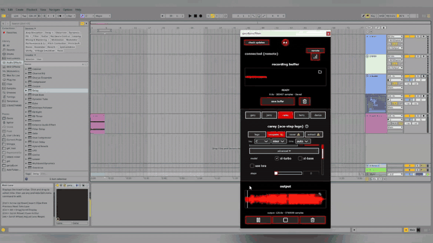

# gary4juce

**gary v5: yue2 and a native stem separator are now inside the DAW.**

a VST3/AU plugin for musicians who want AI to meet them where they actually
live. for me, that's ableton. for you, it might be fl studio or, if you're
insane, reaper lol

https://thepatch.gumroad.com/l/gary4juce

**latest stable releases:**

- [gary4juce v5.0.7 (windows VST3 + standalone)](https://github.com/betweentwomidnights/gary4juce/releases/tag/v5.0.7)
- [gary4juce v5.0.7-mac (macOS AU/VST3 + standalone)](https://github.com/betweentwomidnights/gary4juce/releases/tag/v5.0.7-mac)

**Linux preview:**

- [gary4juce v5.0.6-linux-preview.1 (x64 + ARM64 VST3 + standalone)](https://github.com/betweentwomidnights/gary4juce/releases/tag/v5.0.6-linux-preview.1)

**recommended local companions:**

- windows: [gary4local v0.7.6](https://github.com/betweentwomidnights/gary-localhost-installer/releases/tag/v0.7.6)
- Linux (preview): [gary4local v0.7.4 (amd64 + arm64 .deb)](https://github.com/betweentwomidnights/gary-localhost-installer/releases/tag/v0.7.4)
- macOS (Apple Silicon): [gary4local v0.7.6](https://github.com/betweentwomidnights/gary-localhost-installer/releases/tag/v0.7.6)
  (still on the retired gary4local-mac? update it to [v0.4.2](https://github.com/betweentwomidnights/gary-localhost-installer-mac/releases/tag/v0.4.2))



localhost backend source repos:

- windows and Linux: [gary4local](https://github.com/betweentwomidnights/gary-localhost-installer)
- macOS: [gary4local mac](https://github.com/betweentwomidnights/gary-localhost-installer-mac)

videos about it here when i can: https://youtube.com/@thepatch_dev

---

## built for musicians

If you just want pure text-to-music, you probably do not need a VST. This
project exists for people who want AI to sit inside the session with them.

gary4juce now gives you **eight AI music models** directly in your DAW:

- **yuey** ([YuE2](https://github.com/multimodal-art-projection/YuE)) - songs with or without lyrics in your tempo and key, remixes of your audio through its own transcription, continuations, and a score you can edit and drag in as MIDI
- **sa3** ([stable-audio-3](https://github.com/stability-ai/stable-audio-3)) - text-to-audio, loops, transforms, continuations, LoRA blending, seed recall, key/BPM-aware prompting
- **gary** ([musicgen](https://github.com/facebookresearch/audiocraft)) - continuation/anti-looper. Extends your audio in creative directions
- **jerry** ([stable-audio-open-small](https://huggingface.co/stabilityai/stable-audio-open-small)) - BPM-aware 12-second loop generation in under a second
- **rc-jerry** ([foundation-1](https://huggingface.co/RoyalCities/Foundation-1)) - BPM and key-aware 4/8-bar loop generation with structured prompt assembly
- **carey** ([ace-step](https://github.com/ace-step/ACE-Step-1.5)) - stem generation, audio continuation, and remix/cover with lyrics and multilingual support
- **terry** ([melodyflow](https://huggingface.co/spaces/facebook/melodyflow)) - audio transformation. Turn your guitar into an orchestra
- **darius** ([magenta-realtime](https://github.com/magenta/magenta-realtime)) - high-quality 48 kHz continuations with style control (probably deprecating this one soon)

and one thing that isn't a model you prompt: a **stem separator**, built on
[stems.cpp](https://github.com/betweentwomidnights/stems.cpp), that splits
gary's output or your recording buffer into stems on your own machine.

Put it on your master, press play, record some audio, and start iterating.

> yuey runs on the remote backend for everyone, and locally through gary4local v0.4.0 on Windows and macOS.

---

## latest update

### v5.0.7 - 11/24

**one gary4juce on every platform.** macOS builds from main now, like Windows
and Linux, and local mode on a Mac pairs with the new unified
[gary4local v0.7.6](https://github.com/betweentwomidnights/gary-localhost-installer/releases/tag/v0.7.6)
instead of gary4local-mac. if you're staying on gary4local-mac for now, update
it to [v0.4.2](https://github.com/betweentwomidnights/gary-localhost-installer-mac/releases/tag/v0.4.2)
so local jerry keeps working; v0.4.1 and earlier don't work with this version.
gary4local v0.7.6 needs an Apple Silicon Mac; on an Intel Mac the plugin still
works with the remote backend.

output shows as playing once your DAW actually renders it, and previewing a
stem or the saved buffer cancels an output play that's still waiting on the
host. in GarageBand, put gary on the master track; it keeps processing there.

local mode can talk to gary4local on another machine: set `gary4local host...`
in gary settings. localhost errors point at gary4local now instead of Docker
Compose, and Linux gets built-in stem separation.

pair every platform with
[gary4local v0.7.6](https://github.com/betweentwomidnights/gary-localhost-installer/releases/tag/v0.7.6).

older release notes now live in [docs/CHANGELOG.md](docs/CHANGELOG.md).

---

## roadmap

- [x] bring local yuey to macOS (gary4local mac v0.4.0)
- [ ] unify gary4local into one cross-platform app through the [native gary4local migration](https://github.com/betweentwomidnights/gary-localhost-installer#roadmap)
- [x] introduce optional lightweight native stem separator

---

## installation

### windows

The Windows release has two downloads: the VST3 ZIP for use in a DAW and the
standalone ZIP for running gary4juce as its own app.

For the VST3:

1. Close your DAW.
2. Use **Extract All** on the ZIP.
3. Choose `C:\Program Files\Common Files\VST3\` as the destination, or extract
   somewhere else and copy the `gary4juce.vst3` folder there.
4. Reopen your DAW and rescan plugins if needed.

You can put the VST3 literally anywhere as long as your DAW scans that
location. `C:\Program Files\Common Files\VST3\` is just the default path most
DAWs already check.

For the standalone app, extract the standalone ZIP anywhere you want to keep
it, then run `gary4juce.exe` from the extracted `gary4juce-standalone` folder.
If Windows reports missing Visual C++ runtime DLLs, run the included,
Microsoft-signed `VC_redist.x64.exe` once and try again. License and source
information for gary4juce lives in the adjacent `Legal` folder.

If permission errors appear, run Command Prompt as admin:

```bat
xcopy "path\to\extracted\gary4juce.vst3" "C:\Program Files\Common Files\VST3\gary4juce.vst3" /E /I /Y
```

LMMS support is not working yet. We did an initial VST2/LV2 compatibility pass
and documented the exact Windows alpha environment here:
[LMMS compatibility notes](docs/lmms-compatibility.md).

### linux (preview)

both gary4juce and [gary4local v0.7.4](https://github.com/betweentwomidnights/gary-localhost-installer/releases/tag/v0.7.4)
have Ubuntu 24.04 builds for x64 PCs and ARM64 systems such as DGX Spark.
choose the architecture that matches your machine.

for gary4juce, close your DAW, extract the VST3 ZIP and copy the
`gary4juce.vst3` folder into `~/.vst3/`, then rescan. for standalone, extract
the whole `gary4juce-standalone` folder and run `./gary4juce` inside it.

for local generation, install the matching gary4local `.deb` and a Vulkan
runtime through its UI, then download the models you want. see the
[gary4local Linux install guide](https://github.com/betweentwomidnights/gary-localhost-installer/blob/v0.7.4/docs/linux-desktop.md).
GPU drivers, models and backend runtimes are separate downloads.

Linux remains a preview. the gary4local arm64 build has been tested end to end
on a DGX Spark; amd64 has CI checks and still needs real desktop feedback.
gary4juce has a **copy** button beside output for DAWs that can't accept a
plugin drag. built-in stem separation isn't available on Linux yet. see the
[Linux preview guide](docs/LINUX_PREVIEW.md) for dependencies and testing notes.

### macOS AU/VST3/standalone

The macOS release has separate universal DMGs for AU, VST3, and the standalone
app.

1. Quit your DAW and the standalone app.
2. Open the DMG for the format you want.
3. Drag to the matching folder:
   - `gary4juce.component` -> Components (Audio Unit)
   - `gary4juce.vst3` -> VST3
   - `gary4juce.app` -> Applications
4. Reopen your DAW and rescan if you installed a plugin.

GarageBand and Logic use AU. Ableton, FL, Reaper, Cubase, and Bitwig can use
VST3.

---

## backends

The plugin can use either:

- **remote backend** - self-hosted on a DGX Spark, free for now, limited to the models I have loaded
- **localhost** - your machine, requires GPU, full control

Remote base URL: `https://g4l.thecollabagepatch.com`

### gary4local

Use the dedicated apps for localhost:

- windows and Linux: [gary4local](https://github.com/betweentwomidnights/gary-localhost-installer)
- macOS: [gary4local mac](https://github.com/betweentwomidnights/gary-localhost-installer-mac)

They manage local runtimes for gary, terry, jerry, carey, foundation-1, SA3,
and yuey. Model coverage varies by platform. Linux generation uses Vulkan;
Windows supports CUDA or Vulkan. SA3 is available on all three platforms.

the stem separator isn't one of these services. it runs inside the plugin.

gary4local doesn't have to run on the same computer as your DAW. builds newer
than v5.0.6 have a `gary4local host...` option in gary settings: point it at
another machine's name or IP, and local mode talks to gary4local there on the
usual ports. leave it empty for this computer. the gary4local services only
listen on loopback, so the other machine needs a bridge for now; the headless
guide covers [Tailscale and SSH](https://github.com/betweentwomidnights/gary-localhost-installer/blob/main/control-center/runtime-core/README.md#using-gary-from-another-computer).

Recommended hardware:

- 10 GB+ GPU VRAM minimum
- 16 GB+ recommended for heavier local models
- 24 GB+ recommended for Darius-style separate backends

### SA3 backend

SA3 can run on the remote backend:

`https://g4l.thecollabagepatch.com/sa3`

or the local gary4local service on Windows, Linux or macOS:

`http://localhost:8006`

Public upstream repo: https://github.com/stability-ai/stable-audio-3

### Darius backend

Darius is too heavy to run alongside the other gary4local services.

Easiest path: duplicate this Hugging Face Space:

https://huggingface.co/spaces/thecollabagepatch/magenta-retry

Use an L40s or A100-class runtime. Enter the duplicated Space URL in the Darius
tab.

Local Docker option:

```bash
git clone https://github.com/betweentwomidnights/magenta-rt
cd magenta-rt
docker build -f Dockerfile.cuda -t magenta-rt .
docker run --gpus all -p 7860:7860 magenta-rt
```

---

## how to use

1. Put gary4juce on your master track, a bus, or any track you want to listen to.
2. Press play in your DAW.
3. Save the recording buffer when you have audio you want a model to react to.
4. Generate, transform, continue, crop, drag, and repeat.

### yuey tab

yuey uses YuE2.

- **create** - a song in your tempo and key, with lyrics or instrumental. by
  default it renders over a chord scaffold straight away; "let yuey plan" lets
  the model compose the whole score first
- **remix** - transcribe your recording into a score and render it again in a
  new style
- **continue** - extend your audio from its score, or from the audio itself

the prompt is shared across all three, so switching sub-tabs keeps what you
typed.

choose `midi` in remix or continue to drop or pick a melody file, a chords file,
or both. `.mid`, `.midi` and saved MIDI Live Clips (`.alc`) are supported. crop
to whole bars and give both lanes the same length; Gary imports the notes,
not the clip's instrument or effects. the guide explains the supported rhythms
and chord shapes.

every render keeps its score: drag it into your DAW as MIDI, or open the score
window to edit it, transpose it, or halve or double the tempo, and render it
again. the score window has the same prompt box and dice, so you can change the
sound without leaving it.

full guide: [YUEY.md](docs/YUEY.md)

learn more: https://github.com/multimodal-art-projection/YuE

### jerry tab

The Jerry tab now has three sub-tabs:

#### sa3 - stable-audio-3

- Generate text-to-audio up to 380 seconds on localhost or 240 seconds remotely.
- Toggle loop mode for 4/8/16-bar loop generation.
- Transform either the saved recording buffer or the current output audio.
- Continue either the saved recording buffer or the current output audio.
- Use optional key/scale and automatic DAW BPM prompting.
- Use seed recall for reproducible takes.
- Use LoRA sliders in advanced settings. Sliders default to 0.
- Use dice prompts from the default pool, or from selected LoRA pools when one or more LoRA sliders are above 0.

Full guide: [SA3.md](docs/SA3.md)

#### jerry - stable-audio-open-small

- Generates short loops aligned to your DAW BPM.
- Smart loop mode can bias toward drums or instruments.
- Localhost supports custom finetunes through the model picker.

Learn more: https://huggingface.co/stabilityai/stable-audio-open-small

#### rc-jerry - foundation-1

- Generates 4 or 8 bar loops synced to BPM and key.
- Uses structured prompt assembly through knobs, toggles, and tag controls.
- Randomize builds coherent presets through the backend prompt engine.
- Presets can be saved/loaded as `.f1preset` files.
- Available on remote, gary4local windows, and gary4local mac on Apple silicon.

Learn more: https://huggingface.co/RoyalCities/Foundation-1

### gary tab

Gary uses MusicGen continuation models.

- Uses the first selected seconds of your recording buffer.
- Generates continuation audio.
- Output can be cropped, continued, retried, or dragged to the DAW timeline.

Model lists are fetched dynamically from the backend, so the menu depends on
what is loaded locally or remotely.

Learn more: https://github.com/facebookresearch/audiocraft

### carey tab

carey uses ACE-Step.

- **lego** - generate vocals/backing vocals over your audio
- **complete** - extend audio into a full continuation
- **cover** - remix/restyle with caption guidance

there used to be an extract mode here. it's hidden as of v5.0.0 because the
built-in [stem separator](#stem-separator) does that job better.

shared lyrics editor, 50-language support, key/scale/time signature selection,
caption popouts, and LoRA support live here.

for lego mode, regular `acestep-v15-base` is still the safer default if you
don't have a LoRA trained. `xl-base` gets much more interesting when a matching
xl-base LoRA is attached, especially for vocals and backing vocals. some
instrument bleed can happen, but it often fits the source audio anyway.

full guide: [CAREY.md](docs/CAREY.md)

learn more: https://github.com/ace-step/ACE-Step-1.5

### terry tab

- Transforms audio with style presets or custom prompts.
- Can use either the recording buffer or current output audio.
- Undo is available after transforms.

Learn more: https://huggingface.co/spaces/facebook/Melodyflow

### darius tab

- High-quality 48 kHz continuations.
- Style steering with prompts, base model, or custom weights.
- Works on the recording buffer or current output audio.
- Requires a separate backend.

Learn more: https://github.com/magenta/magenta-realtime

### stem separator

this one isn't a tab. it's a `stems` handle at the bottom right of the output
waveform, and of the recording buffer once it has audio. it stays dimmed until
you've installed the runtime and at least one model. click it then and it opens
the stem separator settings, which also live in the settings menu under
`stem separator...`. the
runtime is small (about 19 MB on windows, 6 MB on mac). the models download
from Hugging Face.

- stems attaches to the right in compact layout. in wide layout, it uses the
  model area until you close it, keeping the window the same width.
- pick a model, press separate. every stem gets its own waveform you can play,
  pause and seek.
- drag the stems you want into your DAW. only a stem you drag out is kept. the
  rest are deleted when you close the stems panel.
- drop a stem on the recording buffer to replace what's in it. that's how you
  pull the drums out of something you dragged in from the DAW.
- with `mdx23c_drumsep` downloaded, a drums stem gets a `split kit` button that
  splits it into kick, snare, toms, hi-hat, ride and crash, right there in the
  panel. pick DrumSep from the menu to split the audio itself instead, which is
  what you want for a drum loop. a `from` menu beside it switches between the
  two.
- it's disabled while a generation is running.

you can now drop or pick up to ten minutes of audio into the recording buffer,
regardless of the selected model or local/remote connection, then separate the
whole track. larger files open the selection window so you can choose a section
up to ten minutes. double-click the buffer to select a shorter section for
generation: the window opens at the active model's input limit, and the handles
cannot stretch past it (30 seconds on Terry; 380 on local SA3/Carey or 240 remotely).
an orange hint shows when the buffer exceeds the selected model's
input limit; oversized requests are stopped before upload. importing a full
track does not raise a generator's duration limit.

the buffer grows for long imports when needed; live recording keeps its existing
five-minute limit. separation still computes all the model's stems. none of
the models gets faster from choosing fewer outputs.

it runs on the GPU by default (Vulkan on windows, so NVIDIA, AMD and Intel all
work, and Metal on apple silicon), with a toggle for the CPU. on the CPU,
htdemucs and the UVR cleanup models are the ones to use. the RoFormers are much
slower there, and DrumSep runs at about a tenth of realtime. intel macs are CPU
only.

| model | stems | download |
|---|---|---|
| **stems** | | |
| `htdemucs` | drums, bass, other, vocals | 100 MB |
| `htdemucs_6s` | drums, bass, other, vocals, guitar, piano | 71 MB |
| `htdemucs_ft` | same four as htdemucs, best quality, about 4x slower | 401 MB |
| **vocals and instrumental** | | |
| `mel_band_roformer_kim` | vocals, instrumental | 436 MB |
| `bs_roformer_viperx_317` | vocals, instrumental | 610 MB |
| `mdx_net_kim_vocal_2` | vocals, instrumental; small and quick | 64 MB |
| **noise, echo and reverb** | | |
| `uvr_denoise` | noise, denoised | 121 MB |
| `uvr_denoise_lite` | noise, denoised; smaller and quicker | 17 MB |
| `uvr_deecho_normal` | no_echo, echo | 121 MB |
| `uvr_deecho_aggressive` | echo, no_echo; removes more | 121 MB |
| `uvr_deecho_dereverb` | no_reverb, reverb; echo and reverb together | 213 MB |
| `bs_roformer_dereverb_room` | noreverb, reverb; for vocals recorded in a room | 112 MB |
| **drum kit** | | |
| `mdx23c_drumsep` | kick, snare, toms, hh, ride, crash; feed it drums | 417 MB |

the cleanup models each give you both halves, the clean audio and what was
taken out of it, so you can keep either. the two de-echo models list them in
opposite orders because that's how UVR trained them.

`htdemucs` is the default. `bs_roformer_viperx_317`, `mdx_net_kim_vocal_2`,
`mdx23c_drumsep` and the five `uvr_` models have no license upstream, and
`bs_roformer_dereverb_room` is GPL-3.0, so check the [license section](#license)
before you use them for anything beyond your own sessions.

learn more: https://github.com/betweentwomidnights/stems.cpp

---

## building from source

Requirements:

- JUCE 8.0.8
- Visual Studio 2022 on Windows
- Xcode on macOS

Steps:

1. Open `gary4juce.jucer` in Projucer.
2. Save the project to regenerate build files.
3. Open the generated IDE project.
4. Build release configuration.

Linux uses the shared source with a separate CMake build. See the
[Linux preview build instructions](docs/LINUX_PREVIEW.md) for x64/ARM64 dependencies,
builds and regression checks. Windows and macOS continue to use Projucer.

Maintainers: see the [release checklist](docs/RELEASING.md) for packaging and
verification.

---

## community

**discord:** https://discord.gg/VECkyXEnAd

**musicgen community:** https://discord.gg/Mxd3nYQre9

**email:** kev@thecollabagepatch.com

**twitter/x:** https://twitter.com/@thepatch_kev

---

## credits

- **stable-audio-3:** Stability AI ([repo](https://github.com/stability-ai/stable-audio-3))
- **underfit:** dadabots ([repo](https://github.com/dada-bots/underfit))
- **musicgen:** Meta AI / Audiocraft team
- **stable-audio-open-small:** Stability AI
- **foundation-1:** RoyalCities ([model](https://huggingface.co/RoyalCities/Foundation-1), [tools](https://github.com/RoyalCities/RC-stable-audio-tools))
- **ace-step:** ACE-Step team ([repo](https://github.com/ace-step/ACE-Step-1.5))
- **melodyflow:** Meta AI / Audiocraft team
- **magenta-realtime:** Google Magenta team
- **stems.cpp:** tinycrops ([repo](https://github.com/betweentwomidnights/stems.cpp)), the native runtime behind the stem separator
- **htdemucs:** Meta AI ([demucs](https://github.com/facebookresearch/demucs))
- **mel-band-roformer:** KimberleyJSN ([model](https://huggingface.co/KimberleyJSN/melbandroformer))
- **bs-roformer ep_317:** viperx, released through the UVR model repo
- **JUCE:** JUCE framework
- **community finetunes:** lyra, vanya, hoenn, CZ-84, and everyone contributing models

Special thanks to Zach and the guys at Stability for letting me be part of the
Stable Audio 3 beta while this integration came together.

---

## license

The source code and other original material in this repository, including
earlier gary4juce versions authored by the copyright holder, are free software
licensed under the
[GNU Affero General Public License v3.0 only](LICENSE) (`AGPL-3.0-only`).
You may use, study, modify, and redistribute that material under the license.
Redistribution and network use of modified versions are subject to the AGPLv3's
notice and Corresponding Source requirements.

Copyright (C) 2025-2026 Kevin Griffing.
Developed and published by the collabage patch, inc.

This project is built with JUCE 8.0.8 under JUCE's AGPLv3 option. See
[Third-Party Notices](THIRD_PARTY_NOTICES.md) for the pinned JUCE source and
license information.

This license statement is limited to this repository. It does not set the
license for the separate gary4local applications or installers, model weights,
hosted services, or any other separately distributed part of the broader Gary
ecosystem. Consult each project's own license before using or redistributing it.

The AI models and backend services used with gary4juce are separate works and
are not included in this repository. Code and model weights may use different
licenses:

- stable-audio-3: [MIT code](https://github.com/stability-ai/stable-audio-3);
  weights use the Stability AI Community License
- musicgen: [MIT code and CC-BY-NC-4.0 weights](https://github.com/facebookresearch/audiocraft#license)
- stable-audio-open-small:
  [Stability AI Community License](https://huggingface.co/stabilityai/stable-audio-open-small)
- foundation-1:
  [Stability AI Community License](https://huggingface.co/RoyalCities/Foundation-1)
- ace-step 1.5: [MIT](https://github.com/ace-step/ACE-Step-1.5)
- melodyflow:
  [MIT code and CC-BY-NC-4.0 weights](https://huggingface.co/facebook/melodyflow-t24-30secs)
- magenta-realtime: [Apache-2.0 code](https://github.com/magenta/magenta-realtime);
  model-weight terms depend on the selected version
- stems.cpp: [MIT](https://github.com/betweentwomidnights/stems.cpp/blob/main/LICENSE)
- htdemucs: [MIT](https://huggingface.co/thepatch/htdemucs-GGUF) (Meta)
- mel-band-roformer (Kim): [MIT](https://huggingface.co/thepatch/mel-band-roformer-kim-GGUF)
- bs-roformer viperx ep_317: no license upstream. it's
  [published as "other"](https://huggingface.co/thepatch/bs-roformer-viperx-317-GGUF)
  with a notice saying so. treat it as unlicensed.

Always consult the exact upstream code and model version before commercial use
or redistribution.

---

## support the project

If gary4juce is useful to you:

- share your creations and tag `@thepatch_kev`
- contribute finetunes to the community
- help improve docs
- Gumroad: https://thepatch.gumroad.com/l/gary4juce (this is one of the only ways to support the project monetarily rn...working on some easier paths like github sponsors)
